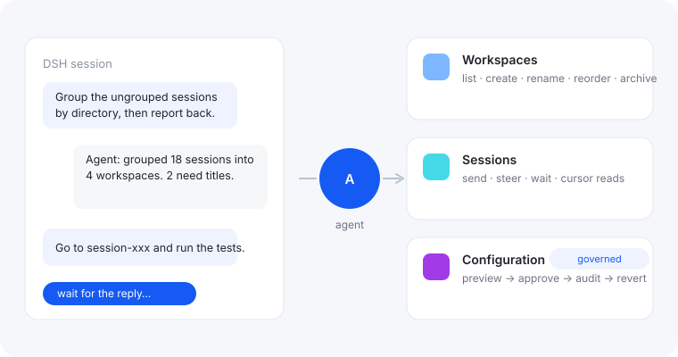

**Let your agent use DSH's own controls.** Workspaces, other sessions, settings — the
operations you normally do in the app, now available to the agent.

An agent can read files and run commands, but it cannot use DSH itself. This plugin gives it
those controls, and puts a review step in front of the risky ones.

## What you can ask for

- “Group the ungrouped sessions under the workspaces that match their directories.”
- “Go to session-xxx, ask it to run the tests, and bring me the summary when it finishes.”
- “Change session-query-sqlite's openAt to never — show me the preview first.”

## Why it is safe

- **Settings changes are reviewed first**: the agent shows a preview, asks for your approval,
  then makes the change — and you can revert it later.
- **Secrets stay hidden**: keys and tokens are masked wherever values are shown.
- **Risky changes are flagged**: settings that DSH needs in order to start come with a warning
  and recovery steps.
- **Nothing happens behind DSH's back**: every action goes through DSH's own services.

## Good to know

- Works with DSH `>=0.2.1-rc.2` or `>=0.2.2-rc.1`.
- The switch on this page turns the plugin on or off. Advanced options (`approval`,
  `requirePreview`, `strictErrors`) are changed by asking the agent — there is nothing to set
  up first.
