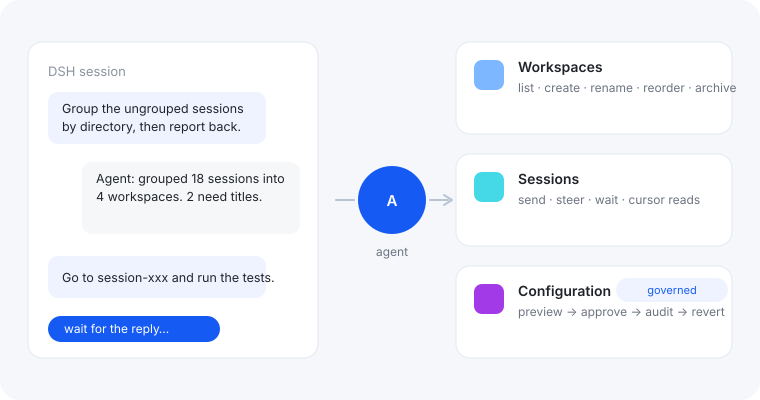

**让 Agent 使用 DSH 自己的控制能力。** 工作区、其他会话、设置——这些你平时在界面上做的
操作，现在 Agent 也能用。

Agent 能读文件、跑命令，但用不了 DSH 本身。这个插件把 DSH 的这些控制能力交给它，并在
有风险的操作前加了一步确认。

## 你可以让它做

- “把未分组的会话按目录归到对应工作区里。”
- “去 session-xxx 让它跑一遍测试，跑完把结果摘要给我。”
- “把 session-query-sqlite 的 openAt 改成 never，先给我看预览。”

## 为什么放心

- **改设置先给你看**：Agent 先给预览、请求你批准，然后才写入；同一次运行内可以撤销，每次写入还会留一张带原始值（敏感字段已掩码）和恢复步骤的收据，插件重新加载后也能照着手工恢复。
- **密钥不外露**：凡是展示值的地方，密钥、token 都会被遮住；工具也拒绝写明文密码/token，请到 Settings 或凭据里设置。
- **高风险改动有提示**：DSH 启动要用的设置被修改时，会给出警告和恢复步骤。
- **不绕过 DSH**：所有操作都走 DSH 自己的服务。

## 你需要知道

- 适用于 DSH `>=0.2.1-rc.2` 或 `>=0.2.2-rc.1`。
- 本页的开关用于启用/停用插件。三个高级选项（`approval`、`requirePreview`、
  `strictErrors`）让 Agent 改即可，不需要预先配置。
