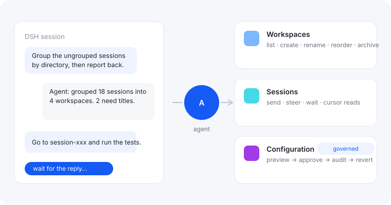

**Agent 现在可以真正在 DSH 内部工作了。** 工作区、会话、配置——那些本来只有人能在界面上做的
操作，变成 Agent 可以安全使用的工具。

## 它改变了什么

在此之前，Agent 能读文件、跑命令，但想整理 DSH 里的东西就得先离开 DSH。有了它，Agent 可以：

- **整理工作区**——把侧边栏里的项目分组、改名、排序、归档；
- **在其他会话里干活**——把任务交给另一个会话，等回复或等一步，只取回新内容；
- **修改 DSH 设置**——先预览，经你批准，留下审计记录，随时可回滚。

## 试着这样说

- “把未分组的会话按目录归到对应工作区里，然后告诉我结果。”
- “去 session-xxx 让它跑一遍测试，跑完把结果摘要给我。”
- “把 session-query-sqlite 的 openAt 改成 never，先给我看预览。”

## 安装

```bash
dsh plugin --profile desktop add dsh-host-ops
```

还没上 npm？`dsh plugin --profile desktop add "github:laughinbytes/dsh-host-ops#main"`。

## 设置

不需要预先配置。三个高级选项（`approval`、`requirePreview`、`strictErrors`）通过让 Agent
修改：它会先预览、请求批准、记录审计。Plugins 页保留常规的启用/停用开关。

## 安全设计

- 配置写入 fail-closed：先预览、再审批、然后才写入，且随时可回滚；
- 敏感值在任何可能展示的地方都被掩码；
- DSH 启动必需的行会得到明确警告与恢复步骤；
- 所有操作都走 DSH 自己的服务，插件从不直接改 DSH 的文件。

*DSH `>=0.2.1-rc.2` 或 `>=0.2.2-rc.1`；Node `>=22.19.0`；macOS 已实测。非官方社区插件。*
